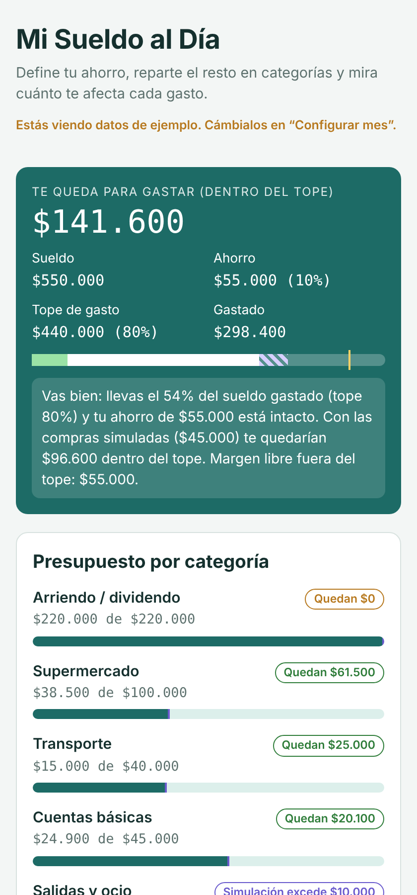

# Mi Sueldo al Día

App web para organizar el sueldo del mes: defines cuánto ahorrar, un tope de gasto y montos por categoría, y ves en tiempo real cuánto te queda y cuánto te afectaría cada compra antes de hacerla.

**[Probar la app](https://eth3rn4l.github.io/mi-sueldo-al-dia/)**

## Funcionalidades

- **Ahorro y tope de gasto** como porcentaje del sueldo, con un margen libre entre ambos.
- **Presupuesto por categoría** con barras de progreso y avisos cuando una categoría se acerca a su límite o lo supera.
- **"¿Y si lo compro?":** simula una compra y muestra su impacto en la categoría, en el tope del mes y en el ahorro antes de registrarla.
- **Vista previa en vivo** del porcentaje del sueldo que representa cada gasto mientras lo escribes.
- Reparto automático del presupuesto entre categorías, mes nuevo y modo oscuro.
- Los datos se guardan en el navegador (`localStorage`); no requiere cuenta ni servidor.

## Tecnologías

HTML, CSS y JavaScript sin frameworks · formato de moneda chilena con `Intl` · diseño mobile-first y accesible.

## Ejecutar localmente

Abre `index.html` en el navegador.
